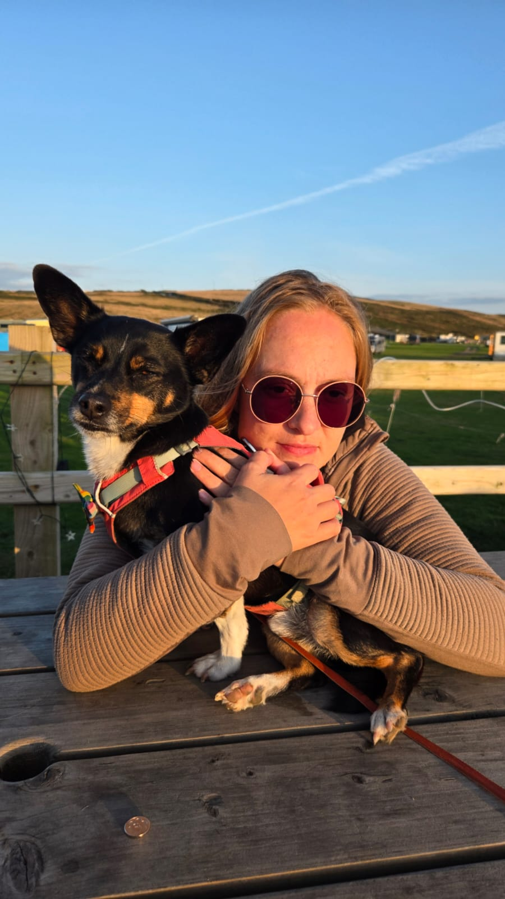
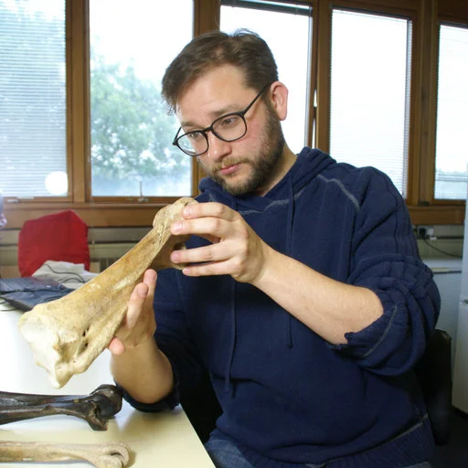

::: hero-slideshow
 
:::

```{=html}
<script>
  let slideIndex = 0;
  const slides = document.querySelectorAll(".hero-slide");

  setInterval(() => {
    slides[slideIndex].classList.remove("active");
    slideIndex = (slideIndex + 1) % slides.length;
    slides[slideIndex].classList.add("active");
  }, 5000);
</script>
```

# About Us

::::: image-grid
::: image-card


<h3>Dr Sarah Jamison-Todd</h3>

<p>Sarah is a research associate in palaeontology at the University of Birmingham with a strong personal interest in community-led conservation biology and a future with mutual benefits between nature and humankind.</p>
:::

::: image-card


<h3>Dr James Hansford</h3>

<p> James is a zoologist and conservation palaeontologist working at the interface of conservation science, palaeobiology, artificial intelligence, and biodiversity policy. </p>
:::
:::::
